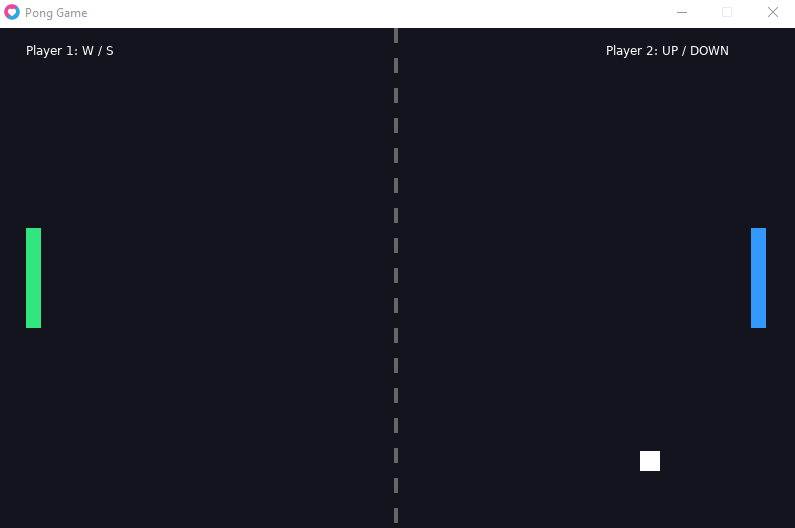

# Pong Game - LÖVE2D

## Student Information
- **Full Name:** Zaid Raed Marouf Khalil
- **Class/Section:** [section 1]

## Game Description
Pong is a simple two-player game developed using Lua and the LÖVE2D framework. Each player controls a paddle and tries to prevent the ball from passing their side. The ball moves around the screen and bounces off the top and bottom walls and both paddles. The game uses delta time (dt) for consistent movement and AABB collision detection to handle collisions.

## How to Run
1. Install LÖVE2D from https://love2d.org/
2. Open the project folder in a terminal.
3. Run the following command:

`love .`

## Controls
- **Player 1 (Left Paddle):** W to move up, S to move down.
- **Player 2 (Right Paddle):** Up Arrow to move up, Down Arrow to move down.

## Own Feature
The ball increases its horizontal speed by 5% after every paddle collision. This makes the game more challenging as the ball moves faster during longer rallies.

The left paddle is green, and the right paddle is blue to make them easy to distinguish.

## Demo Recording
The demo video was recorded using temporary automatic paddle movement because the physical keyboard was not working. The final submitted game uses manual keyboard controls.

## Screenshot

## Demo Video
[Watch Pong Gameplay Demo](demo/pong-demo.mp4)

## Technologies Used
- Lua
- LÖVE2D
- Git and GitHub
